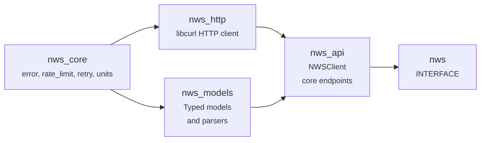

# nws-cpp

[](https://github.com/Reddimus/nws-cpp/actions/workflows/ci.yml)
[](https://github.com/Reddimus/nws-cpp/releases)
[](https://en.cppreference.com/w/cpp/23)
[](https://opensource.org/licenses/MIT)

C++23 SDK for the [National Weather Service API](https://api.weather.gov/) (api.weather.gov).

Provides typed, `std::expected`-based access to NWS weather data including forecasts, observations, alerts, and more. No API key required.

## Quick Start

```cpp
#include "nws/nws.hpp"
#include <iostream>

int main() {
    nws::NWSClient::Config config;
    config.http.user_agent = "(myapp, contact@example.com)";
    nws::NWSClient client(std::move(config));

    // Get forecast for Austin, TX
    auto forecast = client.get_forecast_for_location(30.2672, -97.7431);
    if (!forecast) {
        std::cerr << forecast.error().message << "\n";
        return 1;
    }

    for (const auto& period : forecast->properties.periods) {
        std::cout << period.name << ": " << period.temperature
                  << period.temperature_unit << " - " << period.short_forecast << "\n";
    }
}
```

## Features

- **C++23** with `std::expected<T, Error>` for operation errors
- **Core NWS endpoints**: Points, Forecasts, Observations, Stations, Alerts
- **Unit conversion**: WMO unit codes parsed into typed enums with conversion functions
- **Rate limiting**: Built-in token bucket rate limiter (NWS-tuned defaults)
- **Retry with backoff**: Configurable exponential backoff with jitter
- **Points cache**: Optional LRU cache for lat/lon -> grid coordinate lookups
- **GeoJSON parsing**: Typed `GeoJsonFeature<T>` and `GeoJsonFeatureCollection<T>` wrappers
- **RFC 7807 errors**: NWS Problem Details responses parsed into structured `Error` objects
- **Pimpl pattern**: Client implementation details hidden from public headers

## Building

### Requirements

- C++23 compiler (GCC 13+, Clang 19+ with libstdc++, or Clang 18+ with libc++ 18+)
- CMake 3.31+
- libcurl 7.85+ with thread-safe global initialization

### Build

```bash
make build        # Release build
make test         # Run tests
make lint         # Check formatting
make format       # Format code
make coverage     # Generate coverage report (requires lcov)
```

### CMake Options

| Option | Default | Description |
|--------|---------|-------------|
| `NWS_BUILD_TESTS` | Top-level only | Build unit tests |
| `NWS_BUILD_EXAMPLES` | Top-level only | Build examples |
| `NWS_ENABLE_LTO` | Top-level only | Link-time optimization |
| `NWS_NATIVE_ARCH` | `OFF` | `-march=native` tuning |
| `NWS_ENABLE_SANITIZERS` | `OFF` | ASan + UBSan |
| `NWS_ENABLE_COVERAGE` | `OFF` | gcov instrumentation |

### Using as a Dependency

```cmake
find_package(nws CONFIG REQUIRED)
target_link_libraries(myapp PRIVATE nws::nws)
```

Or with FetchContent:

```cmake
FetchContent_Declare(nws-cpp
    GIT_REPOSITORY https://github.com/Reddimus/nws-cpp.git
    GIT_TAG v0.4.0  # pin a tagged release
)
FetchContent_MakeAvailable(nws-cpp)
target_link_libraries(myapp PRIVATE nws::nws)
```

## Architecture



## API Coverage

### Endpoints

The client wraps 20 core GET operations. The upstream [OpenAPI contract](https://api.weather.gov/openapi.json) lists 69 operations as of 2026-10-25.

| Category | Endpoints |
|----------|-----------|
| Points | `get_point()` |
| Gridpoints | `get_gridpoint()`, `get_forecast()`, `get_forecast_hourly()`, `get_gridpoint_stations()` |
| Observations | `get_observations()`, `get_latest_observation()` |
| Stations | `get_station()` |
| Alerts | `get_alerts()`, `get_active_alerts()`, `get_active_alert_count()`, `get_active_alerts_by_area()`, `get_active_alerts_by_zone()`, `get_alert()`, `get_alert_types()` |
| Zones | `get_zone()`, `get_zone_forecast()` |
| Glossary | `get_glossary()` |
| Products | `get_latest_product()`, `get_product()` |

### Convenience Methods

| Method | Description |
|--------|-------------|
| `get_forecast_for_location(lat, lon)` | Auto-resolves point -> grid -> forecast |
| `get_current_weather(lat, lon)` | Auto-resolves point -> station -> latest observation |

### Parsers

Point, Forecast, Observation, Station, Alert, Zone, Gridpoint, Office, Product, Aviation, Radar, and Glossary have typed JSON parsers. Climate products also have `CliReport` and `NbpStation` text parsers.

### Model Types

| Type | Fields |
|------|--------|
| `PointProperties` | gridId, gridX, gridY, forecast URLs, timeZone, radarStation |
| `ForecastPeriod` | temperature, wind, precipitation probability, text forecast |
| `ObservationProperties` | temperature, dewpoint, wind, pressure, humidity, clouds |
| `StationProperties` | identifier, name, timeZone, elevation |
| `AlertProperties` | severity, urgency, certainty, event, headline, description |
| `QuantitativeValue` | value, unitCode, qualityControl + unit conversion |

## Examples

```bash
make run-basic_usage       # Point lookup
make run-get_forecast      # 14-period forecast
make run-get_observations  # Current weather with unit conversion
make run-get_alerts        # Active alerts by state
make run-weather_monitor   # Polling station every 60s
```

`ClientConfig::max_response_bytes` limits decompressed HTTP bodies to 64 MiB;
set it to `0` to disable the limit. Only HTTP(S) URLs and redirects are accepted.

## NWS API Notes

- **No API key** required. A `User-Agent` header is mandatory.
- **Rate limiting**: Undisclosed thresholds; SDK defaults to a burst of five, then one token/sec. Each retry takes a token.
- **Response format**: GeoJSON (`application/geo+json`) with nested `properties` objects.
- **Errors**: RFC 7807 Problem Details with `correlationId` for debugging.

## Dependencies

| Library | Purpose | Integration |
|---------|---------|-------------|
| libcurl | HTTP requests | `find_package(CURL)` |
| [Glaze](https://github.com/stephenberry/glaze) v9.0.0 | JSON parsing | `FetchContent` |
| GoogleTest | Unit testing | `FetchContent` |

## References

- [NWS API Documentation](https://www.weather.gov/documentation/services-web-api)
- [NWS API Community Docs](https://weather-gov.github.io/api/)
- [NWS API OpenAPI Spec](https://api.weather.gov/openapi.json)
- [NWS API General FAQ](https://weather-gov.github.io/api/general-faqs)

## Contributing

Issues and pull requests are welcome. For non-trivial changes please
open an issue first to discuss the approach. Local dev loop:

```bash
make build           # cmake -B build && cmake --build build
make test            # ctest --output-on-failure
make lint            # clang-format --dry-run -Werror
make format          # clang-format -i (call before pushing)
```

CI runs the same lint+build+test on push and PR (Ubuntu 24.04 +
macos-latest); see `.github/workflows/ci.yml`.

## License

MIT
